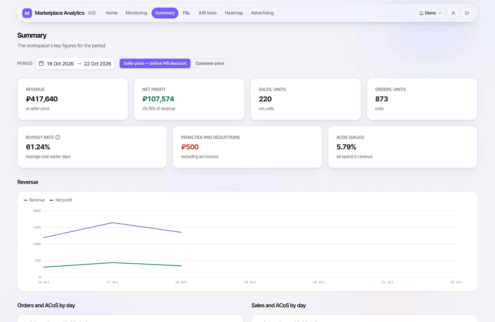
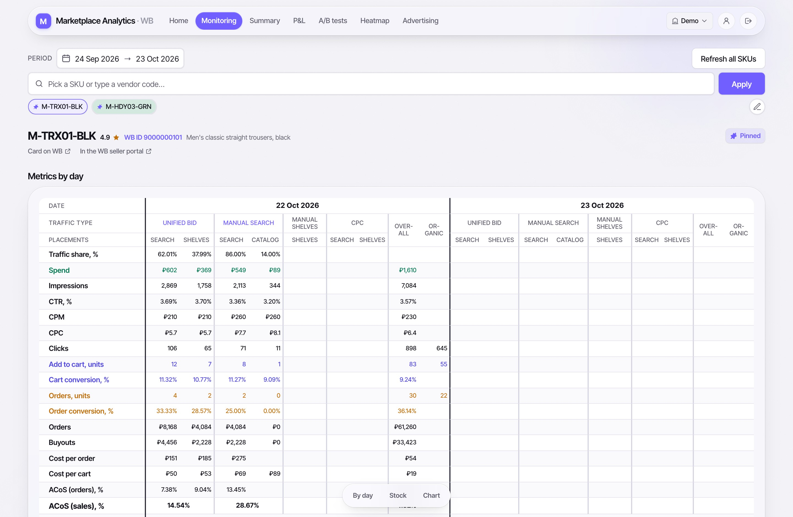
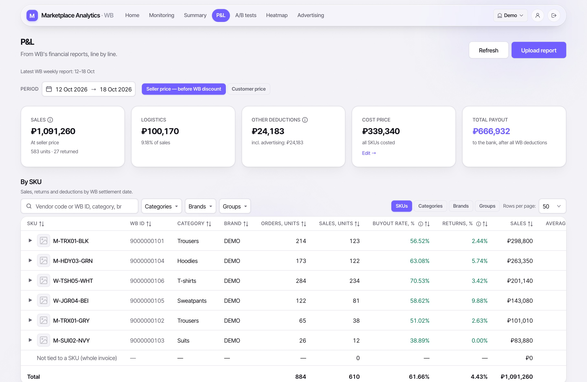
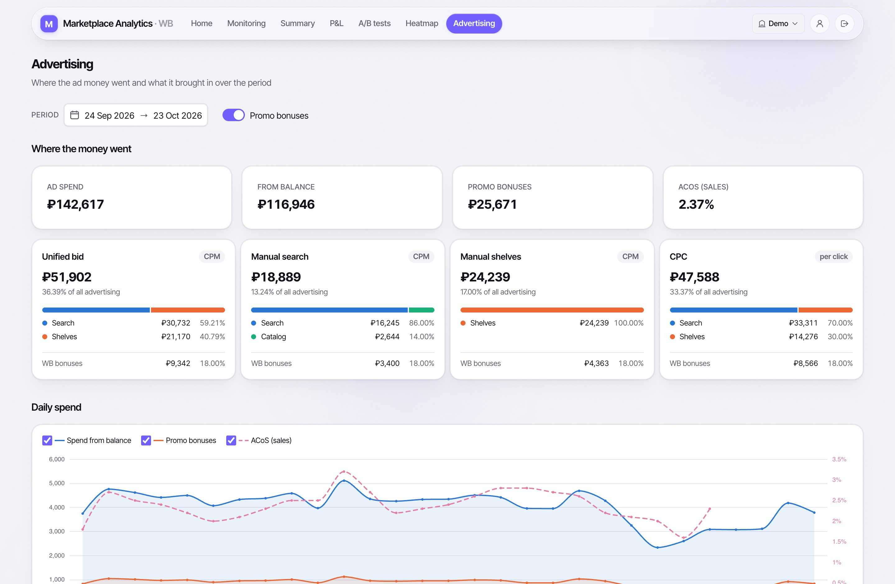
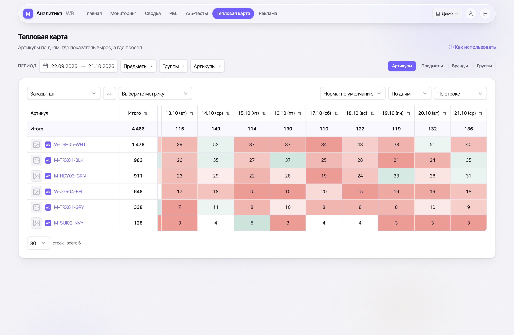
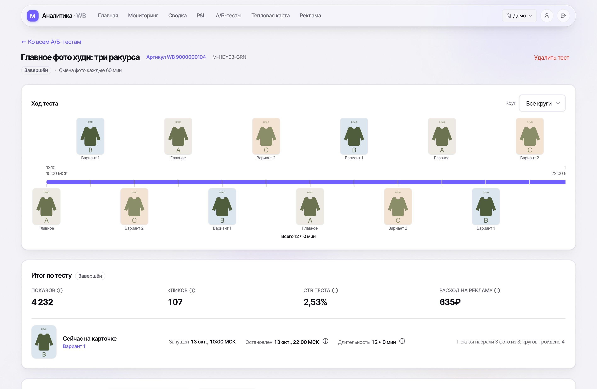
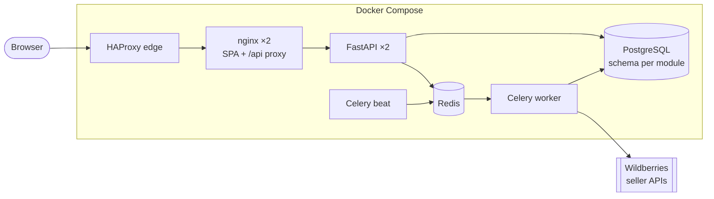

# Marketplace Analytic Service

Analytics for sellers on [Wildberries](https://www.wildberries.ru), the Russian online
marketplace. It pulls a seller's data from the Wildberries seller APIs every night —
card funnel, prices, stock, advertising statistics, weekly settlement reports — and turns it into
the views a seller works from every morning: a per-article daily matrix, a P&L built line by line
from Wildberries' own settlement rows, where the advertising money went, a heatmap of the whole
catalogue, and A/B tests of a card's main photo.

> **The UI is in Russian** — the product targets the Russian-speaking Wildberries market. Code,
> comments, docs and commit history are in English; a [glossary](#glossary) below maps the
> Russian terms on the screenshots.

**Try it in one command** — no Wildberries account needed, everything runs on a fabricated shop:

```bash
cp backend/.env.example backend/.env
make demo        # then open http://localhost:8080
```

## Screenshots

All figures are fabricated by the demo seed (`backend/scripts/seed_demo/`): six invented articles
of the brand «DEMO», a year of history, nine weekly reports.

**Summary** — the workspace's week: revenue, net profit, units, orders, buyout rate, penalties and
the ad cost ratio, with daily charts.


**Monitoring** — one article, day by day: traffic, spend and conversions per advertising zone
(unified and manual bids, CPC; search, shelves, catalogue) against organic, then prices, stock and
the buyout rate. Cells are editable; the backend recomputes what depends on them.


**P&L** — built from Wildberries' weekly settlement reports, row by row: sales at the seller's
price, logistics, deductions, cost of goods and the payout, then the same per article.


**Advertising** — where the money went, by bid type and placement, how much of it Wildberries paid
in promo bonuses, and the ad cost ratio against settled sales.


**Heatmap** — every article × every day for any of 25 metrics, by day, week or month, with
per-article norms and the seller's own groups.


**A/B photo test** — the card's main photo rotated across variants by time or by impressions, each
exposure measured from the advertising statistics of its own window.


## What it does

* **Harvesting.** Nightly Celery tasks walk the Wildberries seller APIs per workspace — content,
  analytics, prices, statistics, advertising, finance, marketplace (FBS) — through client-side
  rate buckets sized from limits measured against the live API, not from the documentation.
  Tokens are stored per workspace, Fernet-encrypted.
* **Monitoring** (`/monitoring`): the daily matrix above, pinned articles, day notes and actions,
  stock by warehouse and size.
* **Summary** (`/summary`): the workspace's KPIs and daily series over any window.
* **P&L** (`/finreports`): the settlement-based statement and per-article P&L with cost prices,
  penalties by reason, advertising and promo bonuses, ROI; stock valued at cost by warehouse; a
  cost-price editor with Excel import and export; manual upload of a report file. How each line is
  derived is in [`docs/finreports/PNL.md`](docs/finreports/PNL.md).
* **Advertising** (`/advertising`), **Heatmap** (`/heatmap`), **A/B tests** (`/ab-tests`).
* **Accounts and access**: companies, several workspaces («кабинеты») per company, invitations,
  per-page grants for managers, read-only guests, subscriptions.
* **Capture of expiring feeds** (`guide` module): several Wildberries feeds are served over a
  window that closes for good — return claims live fourteen days — so they are stored verbatim now,
  before anyone knows what to ask of them.

## Stack

| | |
|---|---|
| Backend | Python 3.12, FastAPI, SQLAlchemy 2 (async, asyncpg), Alembic, Pydantic 2, Celery, httpx |
| Data | PostgreSQL 16 (one schema per module, row-level security), Redis 7 (broker, rate buckets, revocation) |
| Frontend | Vue 3 (`<script setup>`), Vite, Pinia, Tailwind CSS, PrimeVue (unstyled), ECharts |
| Edge | HAProxy in front of two nginx, two API instances — any one can be replaced while its twin serves |
| Observability | Prometheus, Alertmanager, Grafana, Loki + Alloy, Sentry; structlog with a redaction filter |
| Quality | pytest, Vitest, Playwright, k6, ruff, mypy `--strict`, ESLint, Prettier, pip-audit, npm audit |
| Delivery | Docker Compose, GitHub Actions, Release Please, conventional commits enforced by commitizen |

## Architecture

A modular monolith. Each backend module owns its routers, services, repositories, models and its
own PostgreSQL schema, and talks to other modules **only** through their `contract.py`; the
frontend mirrors it with one `index.js` per module.



```
backend/src/modules/   users · organizations · workspaces · monitoring · finreports
                       advertising · summary · heatmap · ab_tests · guide
frontend/src/modules/  auth · profile · monitoring · finreports · advertising
                       summary · heatmap · abTests
```

## Engineering decisions

What sets this apart from a tutorial project is mostly what is **enforced** rather than written
down:

* **Architecture rules are tests.** No horizontal imports between modules, a public contract per
  module whose every name must resolve, and a hard 500-line ceiling per file are asserted by
  `backend/tests/unit/core/test_module_boundaries.py`; the frontend's boundaries are fatal ESLint
  rules plus `frontend/tests/integration/architecture.spec.js`.
* **Tenancy is enforced twice.** Every query is scoped to the workspace in the request header, and
  PostgreSQL row-level security enforces the same boundary underneath, for an API that connects as
  a least-privilege role that does not own its tables. Ad-hoc looks at production data go through a
  read-only session pinned to one workspace. See
  [`docs/security/SECURITY_DESIGN.md`](docs/security/SECURITY_DESIGN.md).
* **Sessions.** A 15-minute access token held in memory, an opaque rotating refresh token stored as
  a digest, replay detection that revokes the token family (RFC 9700), an absolute 30-day ceiling,
  and Redis watermarks so «sign out everywhere» reaches live access tokens immediately.
* **Five test tiers** — unit, component, integration, end-to-end, performance — each with a budget
  and a rule for what it may touch (`.claude/skills/testing/`). About 2,070 backend unit and
  component tests, 570 integration tests against real PostgreSQL and Redis, 1,020 frontend specs,
  Playwright journeys and k6 load profiles.
* **Observability without leaking tenants.** No metric is labelled by tenant and no caller-chosen
  string reaches a label — both enforced by tests; the logs carry the workspace on every line
  instead. See [`docs/monitoring/OBSERVABILITY.md`](docs/monitoring/OBSERVABILITY.md).
* **Fails closed.** A deployed environment refuses to start with a placeholder secret, debug mode,
  CORS on or fabricated harvesting; harvested schemas refuse an unannounced `TRUNCATE` and audit
  every attempt; backups are encrypted with `age` to two recipients
  ([`docs/security/BACKUP_KEYS.md`](docs/security/BACKUP_KEYS.md)).
* **The version is derived, never typed.** Conventional commits are checked at commit time,
  Release Please turns them into versions and a changelog, and the project's own `feat-minor`
  type keeps small features from bumping the minor version
  ([`docs/RELEASES.md`](docs/RELEASES.md)).
* **Built with Claude Code, with the rules in the repository.** `.claude/skills/` holds the
  project's working rules — architecture, security, testing, design system, git workflow — that
  the agent loads when the work calls for them, and most of those rules are pinned by tests rather
  than trusted to the prompt. `docs/JOURNAL.md` records every finished task.
* **Facts about the Wildberries API, measured.** Rate limits, report formation times and
  endpoint behaviour are documented where the code relies on them, from measurements against the
  live API — for example why the P&L reads the finance API and how the old settlement endpoint was
  retired ([`docs/finreports/MIGRATION_TO_FINANCE_V1.md`](docs/finreports/MIGRATION_TO_FINANCE_V1.md)).

## Running it

**Requirements:** Docker with Compose v2, `make`, `curl`. Ports 8080 and 8443 on localhost
(`make demo DEMO_HTTP_PORT=9080` to use another).

```bash
git clone https://github.com/DevSainir/Marketplace-Analytic-Service.git
cd Marketplace-Analytic-Service
cp backend/.env.example backend/.env   # works as is for local use
make demo
```

Open <http://localhost:8080> and log in as **demo@example.com** / **demo-password**. The demo runs
the real topology as its own Compose project, without the scheduler (every scheduled task needs a
Wildberries token) and without TLS. Running `make demo` again rebuilds and re-seeds;
`make demo-down` removes it with its data.

**Development** needs [uv](https://docs.astral.sh/uv/) and Node 22:

```bash
make test-fast          # backend unit + component, frontend unit — the pre-commit gate
make test-integration   # real PostgreSQL and Redis
make lint typecheck     # ruff, ESLint, Prettier, mypy --strict
make                    # every target, including the e2e and performance tiers
```

`make up` runs the development stack; copy
`backend/docker/docker-compose.override.yml.example` first to publish the API, PostgreSQL and
Redis on loopback.

## Repository layout

```
backend/
  src/core/            config, database, security, Celery, observability, tenancy
  src/modules/         one package per domain (see Architecture)
  src/integrations/    Wildberries clients, rate buckets, other outbound HTTP
  alembic/             migrations
  scripts/             demo seed, diagnostics, backups, one-off maintenance
  docker/              Dockerfile, compose files and overlays, HAProxy, observability
  tests/               unit · component · integration
frontend/
  src/core/            API client, router, shared components, styles
  src/modules/         one folder per domain, each with its index.js contract
tests/                 end-to-end (Playwright) and performance (pytest, k6)
docs/                  P&L derivation, security design, observability, releases, journal
.claude/               the project's working rules for Claude Code, and its hooks
```

## Glossary

| Russian (UI) | Meaning |
|---|---|
| Кабинет | A seller account on Wildberries — a **workspace** in the code |
| Артикул WB / артикул продавца | WB's article id (`nm_id`) / the seller's own article code |
| Мониторинг | Monitoring — the per-article daily matrix |
| Сводка | Summary |
| Тепловая карта | Heatmap |
| Реклама, РК | Advertising, an advertising campaign |
| Единая ставка / ручная ставка / CPC | Unified bid / manual bid / cost-per-click campaigns |
| Поиск / полки / каталог | Ad placements: search results / recommendation shelves / catalogue |
| Органика | Organic (non-advertising) traffic |
| ДРР | Ad cost ratio — advertising spend as a share of orders or sales |
| СПП | Wildberries' own customer discount, applied on top of the seller's price |
| Цена селлера / цена реализации | Seller's price before WB's discount / what the buyer paid |
| Выкуп | Buyout — an order the buyer kept rather than refused |
| Остатки | Stock |
| Себестоимость | Cost price (cost of goods) |
| Логистика / удержания / штрафы | Delivery fees / deductions / penalties withheld by Wildberries |
| К оплате, итого к оплате | The payout Wildberries transfers to the seller |
| Промо-бонусы | Wildberries' promo bonuses that pay for part of the advertising |
| Еженедельный отчёт | Wildberries' weekly settlement report (the P&L's source) |

## About

Designed and built by [DevSainir](https://github.com/DevSainir) from July 2026, with Claude Code as
a pair programmer: product, backend, frontend, infrastructure and operations. This repository is a
portfolio snapshot of the project — data, credentials and infrastructure details were removed from
its whole history, and everything the demo shows is fabricated.

No license is granted: the code is published to be read, not reused.
